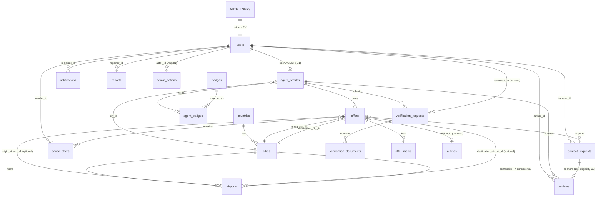

# ERD — THE JOURNEY / الرحلة

> Version 1.0 — August 2026 | Phase 2 Output
> Conceptual model. Field-level detail: `DATABASE_DESIGN.md`. Decisions: `ARCHITECTURE_DECISIONS.md`.

---

## 1. ENTITY RELATIONSHIP DIAGRAM



---

## 2. ENTITY RATIONALE — WHY EACH EXISTS

| Entity | Exists because | MVP? | Source of truth? | Derived/read-model? | Postponable? |
|---|---|---|---|---|---|
| `users` | Single identity + role for authz across all roles | **YES — Slice 0** | YES | — | No |
| ~~`profiles`~~ | — | NO | — | — | **REJECTED** (traveler data lives in `users`; §2.1 DB_DESIGN) |
| `agent_profiles` | Public professional face; trust status; reputation aggregates | **YES — Slice 0/2** | Content+status: YES · metrics: read-model | Metrics ⟲ trigger-maintained | No |
| `verification_requests` | Auditable attempt history for human review (C3-adjacent trust integrity) | **YES — Slice 2** | YES | — | No |
| `verification_documents` | Sensitive files need own lifecycle/retention separate from request state | **YES — Slice 2** | YES (pointers; blobs in private storage) | — | No |
| `countries` | Root of structured geography (C1); ISO anchoring prevents garbage | **YES — Slice 0 (seeded)** | YES | — | No |
| `cities` | Canonical route node + autocomplete + popular-discovery | **YES — Slice 0 (seeded)** | YES | normalized names ⟲ generated | No |
| `airports` | Flight-granular filtering/display without polluting city routes | **YES — Slice 0 (seeded)**; consumed from Slice 1 | YES | — | Schema now, deep UI later |
| `airlines` | Structured carrier reference for flight offers/filter | Same pattern as airports | YES | — | Same |
| `offers` | The core marketplace entity | **YES — Slice 1 (read) / 2 (write)** | YES | view/contact counters ⟲ | No |
| `offer_media` | Ordered imagery per offer | **YES — minimal (Slice 2 write)** | YES | — | Could start text-only; table kept in schema v1 to avoid migration churn |
| `contact_requests` | The conversion bridge + review-eligibility anchor (C3) | **YES — Slice 3** | YES | — | No |
| `reviews` | Trust signal mechanically bound to real interactions | **YES — Slice 4** | YES | — | No |
| `badges` | Meaningful-trust-marks catalog with criteria (anti-decorative rule) | **YES — Slice 4 (catalog seeded)** | YES | — | UI beyond VERIFIED/LICENSED deferrable |
| `agent_badges` | Admin award ledger with revocation audit | **YES — Slice 4 (light)** | YES | — | Yes (UI), schema kept |
| `notifications` | Event-driven lifecycle UX (approvals, expiry, responses) | **Slice 5** | YES (events) | — | Build later per slice plan; schema in v1 acceptable but optional |
| `saved_offers` | Traveler retention loop; feeds expiring-saved alerts | **Slice 4** | YES | — | Yes |
| `reports` | Abuse channel required by trust positioning (schema-first) | **Schema v1; admin queue UI postponed** | YES | — | Yes (UI) |
| `admin_actions` | Append-only auditability for every privileged decision | **YES — first admin op (Slice 2)** | YES (append-only) | — | No |

### Deliberately absent (rejected/postponed — see DATABASE_DESIGN §8)
`profiles` · `offer_routes` · `follows` · posts/community · conversations/messages · payments · saved_searches · currency-conversion tables.

---

## 3. KEY INTEGRITY MECHANISMS (visual summary)

```text
1. Composite FK          offers(origin_airport_id, origin_city_id) → airports(id, city_id)
                         ⇒ an airport refinement can never contradict its route city.

2. Eligibility chain     reviews.contact_request_id UNIQUE + status='RESPONDED'
                         + responded_at + 90 days >= now() check (server-side fn)
                         ⇒ no interaction, no late review (C3 + 90d window, B2).

3. Denormalized anchor   contact_requests.agent_id = offers.agent_id (trigger-checked)
                         ⇒ cheap, safe agent-inbox RLS without joining through offers.

4. One live request      UNIQUE(traveler_id, offer_id) WHERE status IN ('NEW','VIEWED')
                         ⇒ anti-spam without blocking legitimate re-contact.

5. State machines        Status columns mutated only via transition functions;
                         triggers assert legal pairs (AD-08 / DB_DESIGN §4).

6. Append-only ledger    admin_actions has no UPDATE/DELETE path at grant or policy level.
```

---

*Document Owner: Architecture*
